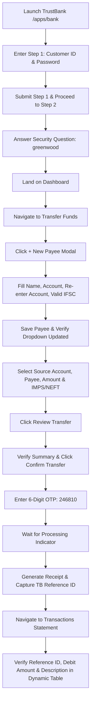

# Critical Workflow & Test Scenarios Specification: TrustBank (PW-POC-02)

**POC ID:** PW-POC-02  
**Owner:** Dinesh K  
**Domain:** Banking & Financial Services  
**Application Target:** TrustBank ([https://www.practiceqaautomation.com/apps/bank](https://www.practiceqaautomation.com/apps/bank))  
**Total Documented Scenarios:** 23 Test Cases (11 Positive, 6 Negative, 6 Validation)  

---

## 1. End-to-End Workflow Architecture

---

## 2. Three Critical End-to-End Workflows Automated

### Workflow 1: Primary Happy Path with New Beneficiary Registration (`TC_POS_04`)
- **Journey:** Two-Step Login ➜ Dashboard ➜ Open `+ New Payee` modal ➜ Register dynamic beneficiary (`Devika xxxx` + `TRST0001234`) ➜ Transfer ₹750.00 via IMPS ➜ Verify review summary ➜ Authorize via OTP `246810` ➜ Capture dynamic Reference ID (`TB...`) ➜ Audit statement history ledger confirming reference and debit line item.

### Workflow 2: Workflow Variation with NEFT Mode & Existing Payee (`TC_POS_05`)
- **Journey:** Authenticated Session ➜ Transfer Funds ➜ Select existing beneficiary (Priya Nair) ➜ Transfer ₹1,200.00 via NEFT mode ➜ Review summary ➜ OTP authorization ➜ Receipt verification ➜ Dynamic statement search and verification.

### Workflow 3: Sourced from Current Account with IMPS (`TC_POS_06`)
- **Journey:** Authenticated Session ➜ Transfer Funds ➜ Switch source from default Savings to Current Account (`index: 2`) ➜ Select utility payee (City Electricity Board) ➜ Transfer ₹650.00 via IMPS ➜ OTP authorization ➜ Ledger audit confirming Current account debit entry.

---

## 3. Comprehensive Matrix of 23 Automated Test Scenarios

### Category A: Positive Test Scenarios (11 Test Cases)

| Test ID | File | Test Description & Business Validation |
| :--- | :--- | :--- |
| **`TC_POS_01`** | `tests/smoke/login.spec.ts` | Verify successful two-step authentication for valid retail customer (`100200300`). |
| **`TC_POS_02`** | `tests/smoke/login.spec.ts` | Verify successful two-step authentication for Branch Manager role (`900800700` landing on `/approvals`). |
| **`TC_POS_03`** | `tests/smoke/login.spec.ts` | Verify session timer is active, session extension works, and customer can log out. |
| **`TC_POS_04`** | `tests/smoke/critical-flow.spec.ts` | **Critical E2E Workflow 1:** Full banking journey (Login ➜ Add Payee ➜ Transfer IMPS ➜ OTP ➜ Receipt ➜ History Audit). |
| **`TC_POS_05`** | `tests/regression/e2e-workflow.spec.ts` | **Critical E2E Workflow 2:** Transfer funds using NEFT mode to existing payee and verify in statement. |
| **`TC_POS_06`** | `tests/regression/e2e-workflow.spec.ts` | **Critical E2E Workflow 3:** Transfer funds sourced from Current Account with OTP and receipt validation. |
| **`TC_POS_07`** | `tests/regression/e2e-workflow.spec.ts` | Edit transfer details from Review screen before OTP confirmation (update amount to ₹450.00). |
| **`TC_POS_08`** | `tests/regression/e2e-workflow.spec.ts` | Dynamic transaction table filtering by Credits only (`+₹`) and Debits only (`−₹`). |
| **`TC_POS_09`** | `tests/regression/account-dashboard.spec.ts` | Verify dynamic recent transactions table structure, row count, and rupee data format. |
| **`TC_POS_10`** | `tests/regression/account-dashboard.spec.ts` | Verify quick action shortcuts on dashboard (Transfer funds, Add payee, Statements navigation). |
| **`TC_POS_11`** | `tests/regression/account-dashboard.spec.ts` | Verify receipt navigation shortcuts return cleanly to transfer form and dashboard. |

### Category B: Negative Test Scenarios (6 Test Cases)

| Test ID | File | Test Description & Trigger Condition |
| :--- | :--- | :--- |
| **`TC_NEG_01`** | `tests/negative/authentication-lockout.spec.ts` | Verify attempt counter countdown on incorrect password (`2 attempts left`, `1 attempt left`). |
| **`TC_NEG_02`** | `tests/negative/authentication-lockout.spec.ts` | Verify 3-attempt account lockout trigger, disabled input, and practice unlock reset. |
| **`TC_NEG_03`** | `tests/negative/authentication-lockout.spec.ts` | Verify rejection of invalid security answer in Step 2 (`That answer doesn't match our records`). |
| **`TC_NEG_04`** | `tests/negative/transfer-validation.spec.ts` | Reject invalid IFSC format when adding beneficiary (`IFSC looks like ABCD0123456`). |
| **`TC_NEG_05`** | `tests/negative/transfer-validation.spec.ts` | Reject mismatched account numbers when adding beneficiary (`Account numbers don't match`). |
| **`TC_NEG_06`** | `tests/negative/transfer-validation.spec.ts` | Reject incorrect OTP during fund transfer verification (`Incorrect OTP. Please try again.`). |

### Category C: Business Validation & Boundary Scenarios (6 Test Cases)

| Test ID | File | Test Description & Assertion |
| :--- | :--- | :--- |
| **`TC_VAL_01`** | `tests/validation/business-rules.spec.ts` | Mandatory field validation on Step 1 login form (`Customer ID must be 9 digits`). |
| **`TC_VAL_02`** | `tests/validation/business-rules.spec.ts` | Mandatory field validation on Add Payee modal form (name, account number, IFSC code). |
| **`TC_VAL_03`** | `tests/validation/business-rules.spec.ts` | Mandatory field validation on Transfer Funds form (account, payee, amount, mode). |
| **`TC_VAL_04`** | `tests/validation/business-rules.spec.ts` | Daily transfer limit boundary rule (amount exceeding ₹50,000 displays limit error). |
| **`TC_VAL_05`** | `tests/validation/business-rules.spec.ts` | Zero amount validation on Transfer Funds form (entering `0` displays `Enter an amount`). |
| **`TC_VAL_06`** | `tests/validation/business-rules.spec.ts` | Role-Based Access Control validation for Branch Manager (accessing transfer triggers `Access denied`). |
